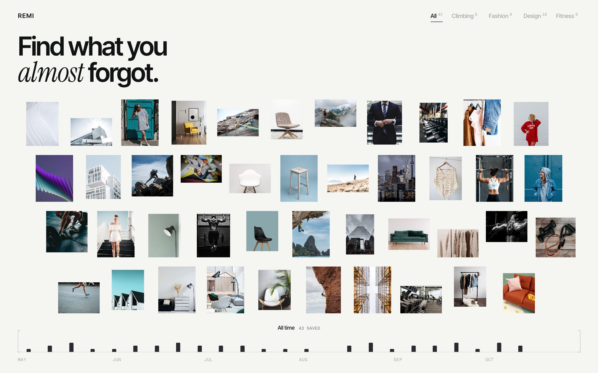
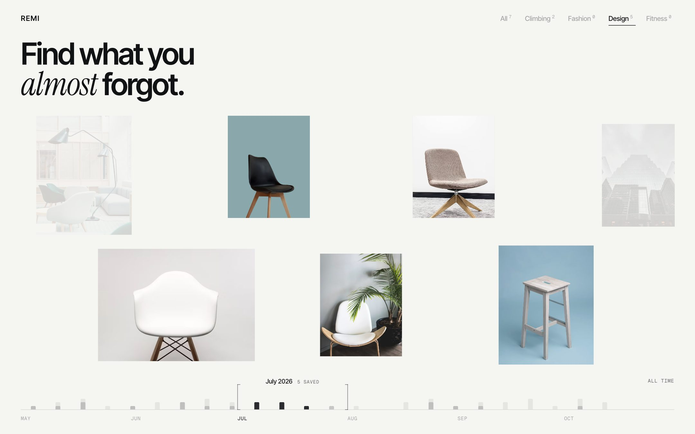
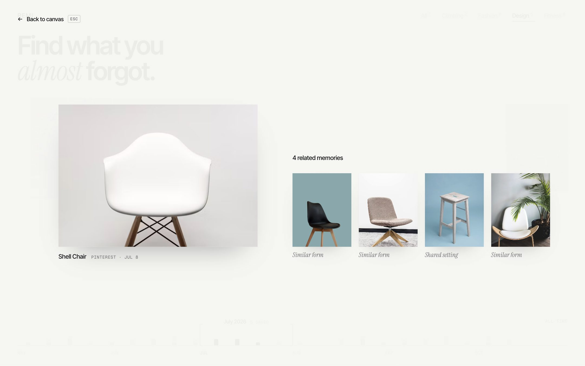

# REMI

**Find what you almost forgot.**

REMI is a high-fidelity interaction study for a visual archive. It helps you rediscover things you saved across platforms: Pinterest, Instagram, Are.na, Behance and the web. There is no feed and no folders. It's one canvas of saved images that you explore two ways, **by category** and **through time**, and any image opens into the memories related to it.

It was built as a Product Design portfolio piece. The art direction is *Editorial Minimalism × Futuristic Liquid*: a pearl-white ground, tight editorial type, curated photography, and liquid-glass effects used only where they help an interaction.



## 中文简介

REMI 是一个视觉档案的高保真交互实验，用来重新发现你在不同平台上收藏过的内容。它没有信息流，也没有文件夹，所有收藏都在同一张画布上。顶部的分类筛选和底部的时间轴操控的是同一批内容：拖动时间轴，图片会沿时间方向平滑移动、缩放；切换分类，无关的图片淡出，相关的图片以弹簧动画重新排布。点击任意图片进入 Focus 模式，查看与它相关的收藏，并可以继续沿着关联浏览。返回画布时，分类和时间位置都保持不变。

这是一个交互设计作品，不是完整的产品。数据是手工编写的示例数据，分类和关联都由人工挑选，并没有实现任何 AI 识别或跨平台同步。

---

## The interaction

### One canvas, two controls

Saved items are laid out chronologically, oldest on the left. The timeline at the bottom works like a minimap of the canvas. Category filters at the top and the timeline both shape the **same** collection.



- **Categories** (All / Climbing / Fashion / Design / Fitness): unrelated images fade where they are, and the rest re-pack with spring animation. Each count reflects the current time range.
- **Timeline:**
  - Weekly ticks show when things were saved. Ticks inside the selected range are charcoal, ticks outside are light grey.
  - Two hairline brackets mark the range. Drag between them to move it, or drag either bracket to resize.
  - The wheel scrubs, the month labels jump to a month, and **All time** returns to the full range.
- **Continuous motion:** positions are fractional in time, so scrubbing pans and zooms the strip smoothly rather than re-dealing a grid. A tile's row count adapts to the screen shape.

### Focus and related memories



- **Open:** click an image and a pearl-glass field expands from the click point. The image travels from its exact place on the canvas into focus.
- **Related memories:** every related item appears in a row, each with one stated connection ("Similar form", "Shared texture", …). The row pages when it doesn't fit.
- **Continue:** choose a related image to make it the focus. The one you came from leads the new row.
- **Return:** Esc or **← Back to canvas**. Images fly home, and the category, time range and keyboard focus are exactly as you left them.

## Data

Everything comes from one file, [`src/data/items.ts`](src/data/items.ts): 43 sample items saved between May and October 2026. Each item has:
- id, title and image
- original platform and saved date
- category
- related item ids, each with a hand-written reason.

Relationships are explicit, curated pairs. Nothing is classified, analysed or synced by software, and every count on screen is computed from this file.

## Motion and accessibility

- **Motion:** springs are critically damped, with no bounce. Tiles use Motion layout animation, with a shorter spring while scrubbing so neighbours never cross.
- **Reduced motion:** `prefers-reduced-motion` is respected. Layout and transform motion jump to their end state, while opacity still fades.
- **Keyboard:** filters, tiles, the timeline and each range bracket, month labels, Focus cards, pager and Back are all reachable.
  - Timeline: ← / → step a week (Shift for a day), PgUp / PgDn step a month, Esc returns to All time.
  - A focused bracket: ← / → resize that edge.

## Built with

React 19, TypeScript, Vite, and [Motion](https://motion.dev) for springs and shared layout transitions. Styling is plain CSS. The Focus refraction uses an SVG displacement filter driven by a generated radial map, with no WebGL.

```
src/
  canvas/   MemoryCanvas, layout (chronological strip), Timeline, CategoryFilter, time
  focus/    Focus state and stage (glass veil, related row, return)
  data/     items.ts (the dataset), graph.ts (focus view of it)
  glass/    radial displacement map for the focus refraction
```

## Run locally

```bash
npm install
npm run dev
```

Then open http://localhost:5173. `npm run build` type-checks and builds to `dist/`.

## Imagery

Photographs are from [Unsplash](https://unsplash.com), used under the Unsplash License and loaded from `images.unsplash.com`.
